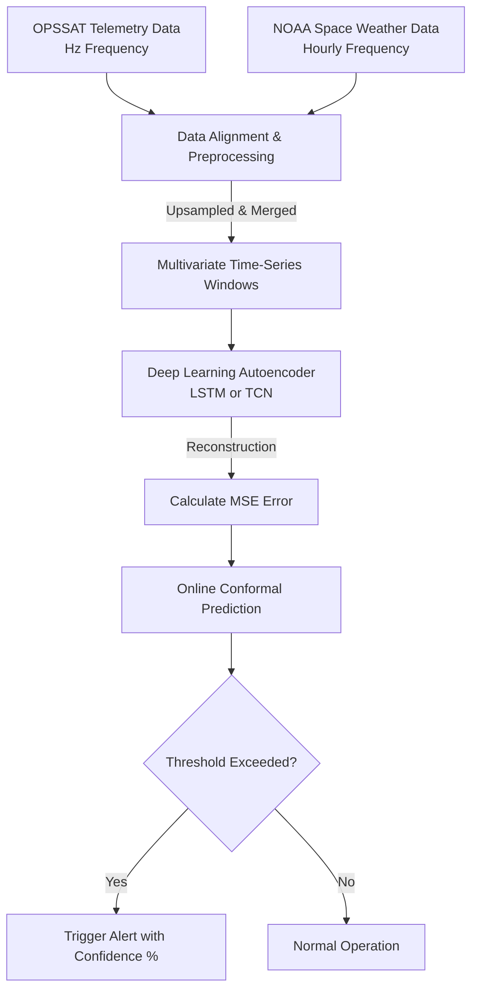

# Methodology Design: Space Weather-Aware Anomaly Detection for CubeSats (SW-ADP)

This document details the methodological design for applying various AI algorithms to the SW-ADP project. It covers both the student's proposed algorithms and the additional algorithms suggested for competitive advantage, along with illustrative examples of data inputs and expected outputs.

---

## 🚀 Sample Algorithm Design Architecture

Here is the high-level workflow of the system, taking raw telemetry and space weather data, running it through the model, and generating calibrated alerts.



---

## 1. Isolation Forest (Student Proposal - Baseline)

**Problem Statement:** Fast, simple anomaly detection is needed to establish a baseline performance metric before testing complex time-series models.

**What we try to solve:** We need a robust model that isolates anomalies instead of profiling normal data points, which is particularly useful for identifying rare, distinct events in single points of time.

**Input Data:** A flattened 1D array of features at a single timestamp $t$. Features include the 9 CubeSat telemetry channels + the aggregated Space Weather indices merged for that exact timestamp.

```json
// Example Input Array at time t
{
  "timestamp": "2024-05-10T14:22:01Z",
  "bat_voltage": 8.1,
  "panel_temp": 45.2,
  "magnetometer_z": 0.54,
  ...
  "Kp_index": 7,  // Space Weather feature
  "F10_7_flux": 180
}
```

**Output Data:** A continuous anomaly score (0 to 1) for the timestamp $t$, and a binary decision (Anomaly vs. Normal).

```json
// Example Output
{
  "timestamp": "2024-05-10T14:22:01Z",
  "anomaly_score": 0.82,
  "is_anomaly": true
}
```

**ML Model:** Isolation Forest (an ensemble of Isolation Trees). It repeatedly partitions the feature space randomly. Anomalies, being "few and different," are isolated closer to the root of the trees.

**Use Case:** Ideal as the "dumb" baseline metric. If adding Space Weather features improves detection by 5%, the core hypothesis is proven.

---

## 2. Matrix Profile / STUMPY (Student Proposal - Temporal Baseline)

**Problem Statement:** Isolation Forest ignores the chronological order of data. We need a baseline model that understands temporal patterns and "motifs" (repeating patterns).

**What we try to solve:** We want to measure the distance between the current time-window of telemetry and the most similar past window to find "discords" (subsequences with no historical match).

**Input Data:** A rolling window of continuous multivariate time-series data.

```text
[Window Size = 100 timestamps]
t_0   to t_100   : [V_0, T_0, Kp_0] ... [V_100, T_100, Kp_100]
t_101 to t_200   : Next window...
```

**Output Data:** A "Matrix Profile" distance score for each window.

```json
{
  "window_start": "t_0",
  "nearest_neighbor_window": "t_minus_5000",
  "euclidean_distance": 14.5, // High distance = discord = anomaly
  "is_anomaly": true
}
```

**ML Model:** STUMPY computationally measures the exact Euclidean distance between all possible subsequences.

**Use Case:** The _temporal_ baseline. Highly interpretable; you can point exactly to the most similar historical pattern.

---

## 3. LSTM Autoencoder (Student Proposal - Primary Neural Model)

**Problem Statement:** Baseline models fail to capture highly complex, non-linear relationships across many sensors over long periods.

**What we try to solve:** We need to learn the "normal" continuous behavior under all space weather conditions, so deviations result in reconstruction errors.

**Input Data:** 3D tensors: `[Batch Size, Sequence Length, Features]`.

```python
# Shape: [32, 50, 12] (32 windows, 50 time steps per window, 12 features)
input_tensor = [
  [ # Window 1
    [8.1, 45.2, ..., 7], # t=1
    [8.0, 45.3, ..., 7], # t=2
     ...
  ], ...
]
```

**Output Data:** A reconstructed 3D tensor of the same size. The final score is the _Reconstruction Error_ (MSE).

```python
# The model tries to rebuild the input. If it fails, the MSE is high.
reconstructed_tensor = [ ... ]
mse_error = 0.095 # Anything > 0.05 might be flagged as an anomaly
```

**ML Model:** Long Short-Term Memory (LSTM) Autoencoder.

**Use Case:** The primary workhorse proposed by the student. Excellent for capturing long-term dependencies, but difficult to run on a TinyML edge device.

---

## 4. Temporal Convolutional Networks (TCN) (Suggested Alternative)

**Problem Statement:** LSTMs are slow to train, prone to vanishing gradients, and highly difficult to compress onto an ESP32 microcontroller for edge inference.

**What we try to solve:** We need sequential pattern recognition with the parallelized processing and easy hardware-deployment of a Convolutional Neural Network (CNN).

**Input Data:** 3D tensors `[Batch Size, Sequence Length, Features]` (Same as LSTM).

**Output Data:**

```json
{
  "reconstruction_error": 0.088,
  "predicted_next_step": [8.1, 46.0, 0.55] // Can also explicitly forecast
}
```

**ML Model:** TCN uses 1D Dilated Causal Convolutions. "Causal" means no future leakage. "Dilated" provides a massive receptive field (looking far back in time).

**Use Case:** **The ideal solution for the TinyML hardware demo.** 1D-CNN operations are highly optimized on edge devices (TensorFlow Lite Micro).

---

## 5. Transformer-Based Models (Suggested Alternative)

**Problem Statement:** LSTMs and TCNs struggle to find correlations between an event that happened 10 hours ago and a sudden voltage drop happening right now.

**What we try to solve:** Apply "Attention" to distant timestamps and understand exact correlations between sudden space weather events and delayed satellite anomalies.

**Input Data:** Embedded sequence tokens containing Telemetry + Space Weather data, with Positional Encoding.

**Output Data:** Anomaly scores derived from attention weights.

```json
{
  "anomaly_score": 0.94,
  "attention_focus": "High attention placed on t-10 hours (Kp index spike)"
}
```

**Use Case:** Best for achieving absolute maximum accuracy in the software simulation phase, though too heavy for edge deployment.

---

## 6. Graph Neural Networks (GNN) (Suggested Alternative)

**Problem Statement:** Current models treat all features as a flat array. They don't know the "Battery Temp" sensor is physically connected to the "Battery Voltage" sensor.

**What we try to solve:** Model the structural, physical relationship between satellite components and how external Space Weather affects those specific relationships.

**Input Data:** A graph topology at each time step.

```text
Nodes: [V1, Temp1, Kp]
Edges: (V1 <-> Temp1), (Kp -> V1)
Attributes: Values at time t
```

**Output Data:** Edge breakage predictions.

```json
{
  "anomaly_detected": true,
  "root_cause": "The relationship between 'Kp_Index' and 'Battery_Voltage' broke correlation boundaries."
}
```

**Use Case:** Best for **Explainability**. Incredibly valuable for operators diagnosing physical hardware failures rather than just seeing a generic "Error".

---

## 7. Online Conformal Prediction (Calibration Requirement)

**Problem Statement:** Arbitrary "Anomaly Scores" (e.g., 0.045 error) mean nothing to operators.

**What we try to solve:** Convert arbitrary scores into a rigid confidence bound.

**Input Data:** Raw anomaly scores outputted by the underlying deep learning model.

```text
Raw Scores: [0.01, 0.015, 0.012, 0.095, ...]
```

**Output Data:** A dynamic, statistically rigorous threshold and human-readable confidence interval.

```json
{
  "alert_status": "CRITICAL",
  "confidence_level": "98.5%",
  "dynamic_threshold_used": 0.08
}
```

**Use Case:** Essential for the "Operator Dashboard" deliverable. Proves the system is ready for real-world space operations where false alarms cost millions.
